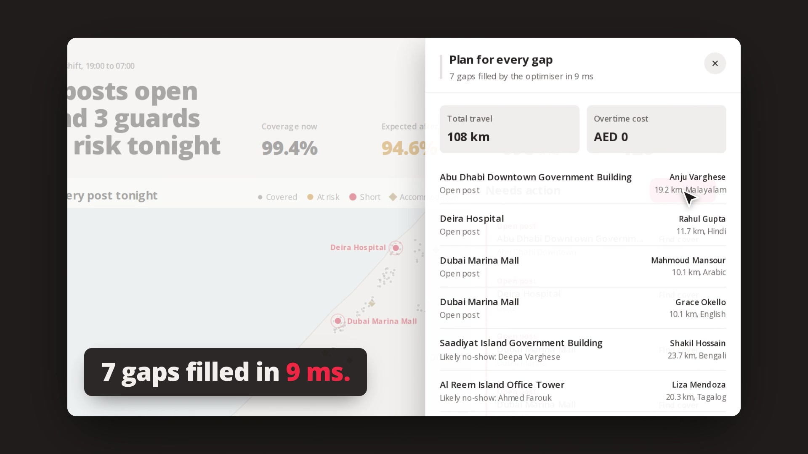

# Transguard Workforce Intelligence (demo)

AI workforce operations demo prepared for Transguard Group by NinjaTech: tonight's guard coverage with likely no-shows and one-click cover, staffing a new contract, a multilingual worker assistant, and facilities ticket triage.

All sites, guards, rosters, payslips and tickets are simulated (fictional names); only area names and the brand are real.

## Links

| | |
|---|---|
| Demo video (24 s) | [brag-output/brag.mp4](brag-output/brag.mp4) ([open on GitHub](https://github.com/bsingh-ninja/transguard_group_demo/blob/main/brag-output/brag.mp4)) |
| Live demo | Runs on the presenter's laptop: http://localhost:3002 (Arabic: http://localhost:3002/?lang=ar). Not hosted yet; see [Run](#run). |
| Code | https://github.com/bsingh-ninja/transguard_group_demo |

[](brag-output/brag.mp4)

The video and the app show Transguard's real brand next to simulated figures. Share them outside NinjaTech only with Transguard's agreement.

Music: "Happy Beats / Business Moves Vol. 11" by Sascha Ende ([ende.app](https://ende.app/en)), CC BY 4.0. Sound effects: Kenney (CC0).

## What we want Transguard to take away

1. **Tonight's risk is visible before the shift starts.** One screen shows every post, the open ones, and the guards likely not to show (a model trained on absence history, commute, consecutive nights, overtime and payday).
2. **Gaps close in one click, within the rules.** The optimiser fills every gap in milliseconds while respecting licences, 12-hour rest, the 60-hour week, travel and reliability. Each guard is told in their own language.
3. **New contracts are answered with numbers.** "Can we staff 40 guards at Dubai Marina?" comes back with how many we cover, how many to hire and which shortfalls (for example female guards) remain.
4. **Every guard gets answers in their language.** Pay, leave, visa, shift and bus questions are answered from the guard's own records, and anything else goes to HR.
5. **Facilities faults are triaged instantly.** A fault report becomes a trade, a priority with response time, likely parts, a checklist and the nearest qualified technician.

In one line: *fewer empty posts, less overtime and faster answers, for a workforce of thousands across many languages.*

## Walkthrough for the meeting (about 10 minutes)

| Step | Screen | Do | Say |
|---|---|---|---|
| 1 | Tonight | Open the app | "702 posts tonight. 4 are empty and 3 guards are likely not to show; coverage falls from 99.4% to 94.6% if nothing is done." |
| 2 | Tonight | **Find cover** on Abu Dhabi Downtown Government Building, then **Approve and notify** | "Ranked replacements with travel, overtime and reliability. Anju Varghese is assigned and gets the message in Malayalam, with the English beside it." |
| 3 | Tonight | **Fill all gaps** | "The optimiser solves every gap at once, in milliseconds, with no overtime." Leave the plan open; approving all seven takes about a minute, because each message is translated (see Notes). |
| 4 | New contract | 40 guards, Dubai Marina, **Check staffing** | "28 from our own free guards, 12 to hire, 2 short on female guards, and where the crew comes from." |
| 5 | Worker assistant | Pick Asif Khan (Urdu), tap the first question | "He asks in Urdu and gets his shift back in Urdu, from his roster. Payslip, leave and visa work the same way." |
| 6 | FM tickets | Deira Hospital lift, **Triage with AI**, **Dispatch technician** | "P1, respond within an hour, likely parts, checklist, and the nearest lift technician assigned." |
| 7 | Tonight | **Reset demo** | Ready for the next run. |

## Pilot we propose

Workforce rostering and backfill in shadow mode for one region or one client cluster, over 6 to 8 weeks, measuring coverage, overtime and time to backfill against the current process.

## Notes before presenting

- Run `./start.sh --reseed` before the meeting, and check that the Gemini key in `backend/.env` works (the assistant, triage and guard messages need it).
- **Approve all and notify** sends each guard's message through Gemini one after another, about 55 seconds for 7 guards. Live, approve a single gap with **Find cover**, or let the sheet finish while you talk.

## Run

```bash
./start.sh            # database (:5434), API (:8002), web app (:3002)
./start.sh --reseed   # reset tonight's roster, workforce and tickets first
```

Open http://localhost:3002 (Arabic: http://localhost:3002/?lang=ar). Requires Docker, Python 3.12 and pnpm. The **Reset demo** link on the Tonight screen restores the starting scenario.

### Gemini key

The worker assistant, ticket triage and worker message translation use Google Gemini. Put your key in `backend/.env` (ignored by git):

```
GEMINI_API_KEY=your-key-here
GEMINI_MODEL=gemini-2.5-flash
```

## CI

`.github/workflows/ci.yml` runs on every push to `main`, on pull requests and by hand:

- **Web app:** install, lint, type check and production build. Set the repository variable `NEXT_PUBLIC_API_URL` to build against a hosted API.
- **API:** Postgres 16 service, seed the demo data, start the API, then `backend/scripts/smoke.py` checks the demo scenario. No Gemini key is needed in CI; the AI features are not called.

The smoke test also runs against the local demo: `cd backend && .venv/bin/python scripts/smoke.py http://127.0.0.1:8002`. 
## Deploy (Hugging Face Space)

The `Dockerfile` runs Postgres, the API and the web app in one container on port 7860; nginx serves the web app and forwards `/api` to the API. The demo data is seeded fresh on every start. Setting `DEMO_PASSWORD` turns on a password prompt (user name `demo`).

Try the container locally:

```bash
docker build -t demo . && docker run --rm -p 7860:7860 -e GEMINI_API_KEY=... -e DEMO_PASSWORD=... demo
```

Deploy by hand (needs `pip install huggingface_hub` and a Hugging Face write token):

```bash
HF_TOKEN=hf_... GEMINI_API_KEY=... DEMO_PASSWORD=... python deploy/hf_space.py <owner>/<space-name>
```

Or deploy from CI: add the repository variable `HF_SPACE` (`<owner>/<space-name>`) and the secrets `HF_TOKEN`, `GEMINI_API_KEY` and `DEMO_PASSWORD`; every push to `main` that passes CI is then deployed. The free CPU Space sleeps after 48 hours without visitors and takes about a minute to wake.

## Screens

| Screen | What it does |
|---|---|
| Tonight | Coverage now and after likely no-shows, map of every post, needs-action list; Find cover (ranked guards) and Fill all gaps (OR-Tools plan); the guard is notified in their own language |
| New contract | Can we staff N guards in an area from free guards, how many to hire, shortfalls, where the crew comes from |
| Worker assistant | Phone-style chat: a guard asks about shift, pay, leave, visa or bus in their language; answers from their records, HR escalation |
| FM tickets | Fault reports (text and optional photo) triaged into trade, priority with response time, parts and checklist; nearest qualified technician; dispatch |

## How it works

- **No-show risk:** logistic regression trained on 200,000 simulated shifts (absence history, commute, consecutive nights, overtime, days since payday).
- **Backfill and new contract:** Google OR-Tools CP-SAT, with licence validity, 12-hour rest, a 60-hour weekly cap, travel and reliability.
- **Assistant and triage:** Gemini function calling and structured output; the assistant must look up the guard's records before answering and replies in the language of the message.

## Layout

```
backend/   FastAPI + Postgres (app/transguard: seed, workforce API, assistant and tickets)
web/       Next.js app (Transguard brand, EN/AR, light/dark)
docs/      plan, brand kit, logo
brag-output/  demo video (brag.mp4), poster, share copy, and its Hyperframes source
```
