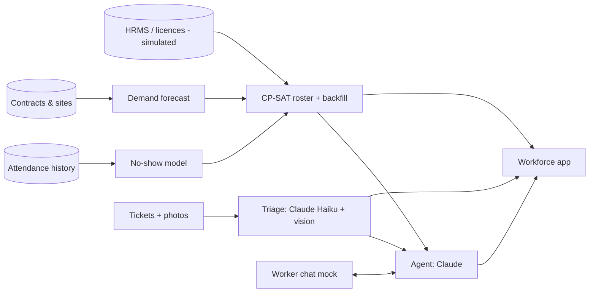

# Plan 2: Transguard, AI Workforce & Operations Intelligence

**One line:** AI for running a 61,000-person workforce. It forecasts staffing demand, builds rosters that respect licensing and labour rules, predicts no-shows and backfills them, sorts facilities work orders, and gives every worker a multilingual assistant.

**Audience:** Transguard operations (security, manpower, facilities, HR outsourcing).
**Key message:** NinjaTech can add AI workflows to the platforms you already run.
**Brand:** Transguard light theme (`transguard`): red `#D71920`, charcoal `#4C4C4D`, gold `#A2844B`, Open Sans.
**Effort:** ~3 weeks with 3 people. A standalone demo: it shares only the foundation (themes, agent service) with Plan 3.

## What Transguard told the world
- **61,000+ people**; Al Hail's site says ~78,500. Calls itself "largest manpower supplier in the UAE" and "largest private security company in the UAE" (17,000+ security professionals).
- Service lines: manned guarding, event security, executive protection, K9; integrated FM (60+ services, 24/7 call centre); manpower supply; HR outsourcing; hospitality staffing; aviation; managed transport, accommodation and catering (Taste of Home).
- Already digital in places: "Smart Security Solutions" (guard management, track-and-trace), a 24/7 operations centre, and the **Launchpad** workforce-onboarding programme (news). **Integrate with these, don't replace them.**

## Modules

### Module A: Demand forecasting and smart rostering (the lead)
- **Forecast** guard and cleaner hours per client site by week and shift, from contracts, events (Expo-style peaks, Ramadan hours, DSF, concerts) and history.
- **Roster optimiser (OR-Tools CP-SAT).** Assigns people to shifts across sites, subject to:
    - SIRA licence validity and type
    - skills (K9, first aid, language)
    - gender requirements per post
    - maximum hours and rest rules under UAE labour law
    - accommodation-to-site transport (their own bus routes)
    - client preferences
- **Output:** a roster plus its cost, its overtime, and how many constraints are violated (zero).
- **What-if:** "A new mall contract needs 40 guards from 1 Dec. Can we cover it, and where from?"

### Module B: No-show prediction and auto-backfill
- **Predict** absence risk per shift from simulated attendance history (patterns after payday, weather, long commutes, recent overtime).
- **Backfill:** when risk is high or a no-show is confirmed, the optimiser proposes the best replacement (licensed, rested, nearest accommodation). The supervisor approves, and the worker is notified in their language.

### Module C: FM work-order triage
- Incoming tickets (email, call-centre notes, photos) are classified by the copilot into trade, priority, SLA and likely parts. Technicians are assigned by skill and location, and a first-time-fix checklist is generated.
- **Photo understanding:** a picture of a leaking AC unit is tagged "HVAC / condensate leak / P2", with a suggested part.

### Module D: Multilingual worker assistant
- A chat assistant (shown as a WhatsApp-style mobile mock) that answers worker questions: payslip lines, leave balance, visa and Emirates ID renewal status, shift times, accommodation bus times, training.
- **Languages:** English, Arabic, Hindi, Urdu, Malayalam, Tagalog, Bengali, Nepali. Voice notes are transcribed and answered in the same language.
- Escalates to HR with a summary. Cuts load on supervisors and PRO desks.

### Module E: Supervisor copilot
- "Which sites are under-covered tonight?", "Show guards whose SIRA licence expires in 30 days", "Draft the monthly SLA report for Client X".

## Demo script (~10 minutes)
1. **Coverage board (2 min):** map of ~120 simulated sites; tonight's coverage is green except 3 sites.
2. **No-show alert (2 min):** 6 high-risk shifts are flagged, and one-click backfill proposes replacements. The supervisor approves, and the worker gets the message in Malayalam on the phone mock.
3. **New contract what-if (2 min):** "40 guards for a new mall from 1 Dec." The optimiser shows a feasible plan, a hiring gap of 12, and the cost.
4. **FM triage (2 min):** drop in 3 tickets with photos; they're auto-classified, assigned and checklisted.
5. **Worker assistant (1 min):** Urdu voice note "when is my visa renewal?" gets an answer and a ticket.
6. **Close (1 min):** "These plug into your guard management, HR and FM systems through APIs. We extend what you have."

**Minimum demo:** Modules A, B and D.

## Architecture

## Simulated data
- 3,000 workers (a manageable demo slice), with nationality and language mix, licences with expiry dates, skills, accommodation and bus routes.
- 120 sites across Dubai and Abu Dhabi (malls, towers, hotels, government), with post requirements per shift.
- 12 months of attendance with planted patterns; 500 FM tickets with ~40 photos (our own or openly licensed).

## Build plan
| Week | Deliverables | Done when |
|---|---|---|
| 1 | Data generator; demand forecast; CP-SAT roster for 3,000 workers / 120 sites / 1 week | Feasible roster in under 60 seconds with zero hard-constraint violations |
| 2 | No-show model + backfill; what-if; coverage map; supervisor copilot | Backfill suggestion in under 3 seconds; what-if answers in under 30 seconds |
| 3 | FM triage with photos; multilingual worker assistant (text + voice); Transguard theme; script and rehearsals | 8 languages pass a 20-question test set; script runs cleanly |

## Risks and mitigations
| Risk | Mitigation |
|---|---|
| Overlap with Launchpad or their existing guard-management system | Ask in discovery; position as an add-on through APIs, with a slide on how it plugs in |
| Labour-law rules modelled wrongly | Keep rules configurable and visible; validate with their HR in the pilot |
| No-show prediction seen as surveillance of workers | Frame it as service continuity; use only operational features; no personal profiling; a human approves every action |
